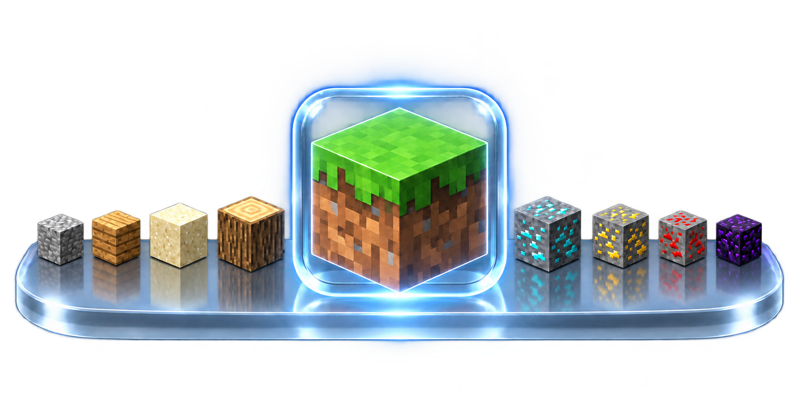

# Minecraft Dynamic Dock
# showcase
[](https://www.youtube.com/watch?v=V3JYOe7aT5c)
An animated liquid-glass hotbar for **Minecraft 26.3**, by **pingplus**. Client-only. This feature is part of the Minecraft untitled-client you can see here https://github.com/PingPongPlus/untitled-client
because the feature is really unique its self so I seperated it. It was inspired by the MacOS dock.

## Install
Download dynamicdock from here: https://github.com/PingPongPlus/DynamicDock/releases/tag/1.0.1

Requires **Java 25**, **Fabric Loader 0.20.0+**, and **Fabric API for 26.3**.
Place `dynamicdock-1.0.1.jar` in your Minecraft instance's `mods` folder.


## Settings

Open **Options > Dynamic Dock**. The optional keybinding is under **Controls → Key Binds → Dynamic Dock**, unbound by default.

Customize glass, tint, scale, magnification, and auto-hide with a live preview.
Settings are saved to `config/dynamicdock.properties`.

## Build

```sh
./gradlew build
```

Output: `build/libs/dynamicdock-1.0.1.jar`.
